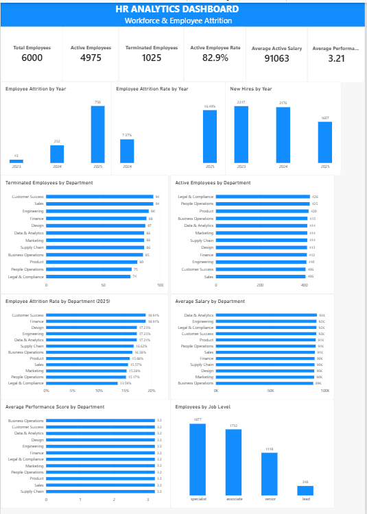

# HR Analytics Dashboard | Power BI

## Project Overview
An interactive HR Analytics Dashboard built using Microsoft Power BI to analyze workforce data, employee attrition, hiring trends, salaries, and performance.

## Dataset
**Workforce & Employee Attrition** – Analytics Engineering

The dataset contains five tables:
- Employees
- Employment Records
- Departments
- Job Roles
- Performance Reviews

## Tools & Technologies
- Microsoft Power BI
- Power Query
- DAX
- Data Modeling
- Data Visualization

## Key Performance Indicators
- Total Employees
- Active Employees
- Terminated Employees
- Active Employee Rate
- Average Active Salary
- Average Performance Score

## Analysis
- Employee Attrition by Year
- Employee Attrition Rate by Year
- Terminated Employees by Department
- Employee Attrition Rate by Department
- New Hires by Year
- Active Employees by Department
- Average Active Salary by Department
- Average Performance Score by Department

## Key Insights
- Employee attrition rate increased from 7.37% in 2024 to 16.49% in 2025.
- New hires decreased from 2,176 in 2024 to 1,607 in 2025.
- Customer Success and Sales recorded the highest termination counts, with 94 each.

## Dashboard Preview

## Project Files
- `HR_Analytics_Dashboard.pbix` – Power BI project file.
- `dashboard-preview.png` – Dashboard screenshot.

## Author
MIS Graduate | Data Analytics & Business Systems
